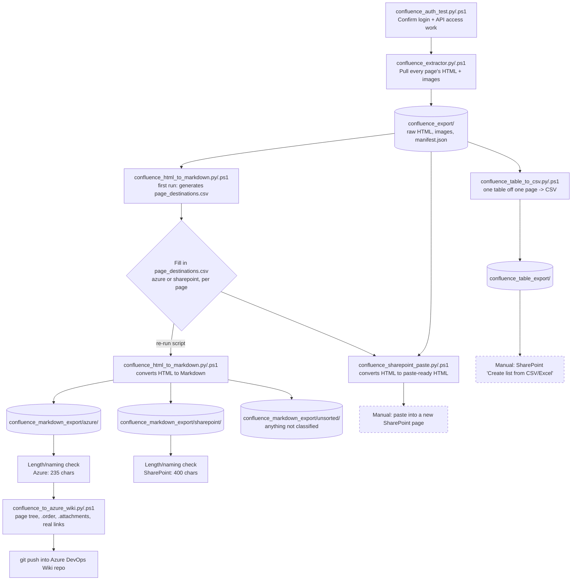

# How the Confluence Migration Pipeline Works

The picture of how the scripts in this repo fit together, start to finish. For what each step actually does, day-to-day usage, and troubleshooting, see the [README](../README.md) and the other pages in this folder - they're the source of truth; this page just shows the shape of it, and links to them for the detail on each step rather than repeating it, so there's only one place to keep up to date.

*(Dashed boxes are the manual steps left - see [Getting pages into SharePoint](sharepoint.md) and [Pages that are really just a table](sharepoint.md#pages-that-are-really-just-a-table) for why, and what a real fix would need.)*

## Stage by stage

1. **Confirm access works** - [How the auth test works](extracting.md#how-the-auth-test-works)
2. **Already got a `confluence_export` folder from before, with garbled characters in it (`Â`, `’`)?** Run `repair_garbled_text` on it now - see [Getting started](getting-started.md), step 3. First time ever running this? Skip straight to step 3, nothing to repair yet.
3. **Pull everything down** - [Pulling everything down](extracting.md#pulling-everything-down)
4. **Classify pages, then convert to Markdown** - [Converting to Markdown](converting-to-markdown.md)
5. **Get pages into Azure DevOps Wiki** - [Getting pages into Azure DevOps Wiki](azure-devops-wiki.md)
6. **Get pages into SharePoint** - [Getting pages into SharePoint](sharepoint.md)
7. **A page that's really just a table?** - [Pages that are really just a table](sharepoint.md#pages-that-are-really-just-a-table) - better off as a SharePoint List

For the full walkthrough with actual commands in order, see [Getting started](getting-started.md).

## Where things actually stand

See [Where things stand](../README.md#where-things-stand) in the README - kept in one place so this page can't drift out of sync with it.

## A couple of things worth remembering

- **Nothing here needs admin access.** Every step uses the same read permission you already have browsing Confluence normally.
- **No credentials are ever stored.** Every script asks for your username and password at runtime and never writes them anywhere.
- **The raw export is never touched by the conversion steps.** Markdown conversion, the SharePoint paste conversion, and the table-to-CSV export all only *read* `confluence_export/` - none of them writes back into it, so re-running any of them is safe. The one deliberate exception is `repair_garbled_text` (step 2 above), which does modify files in `confluence_export/` in place - that's its whole purpose - but it always backs up the original first (`.bak`, or `.stripped.bak` for the `-Force` strip option), so nothing it touches is ever unrecoverable.
- **Small test runs are safe.** The `.ps1` scripts are specifically hardened against a PowerShell quirk where a result set with exactly one item (one page, one attachment, one page in a bucket) can otherwise get silently misread as "nothing" - so extracting or converting just a page or two to try the pipeline out works exactly like a full run would.
